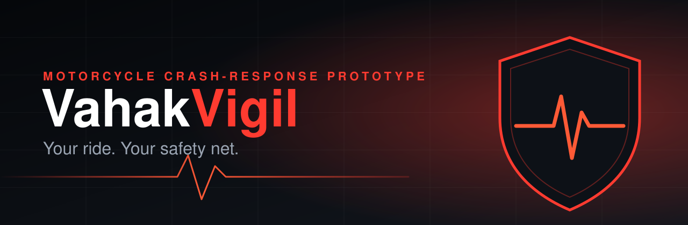
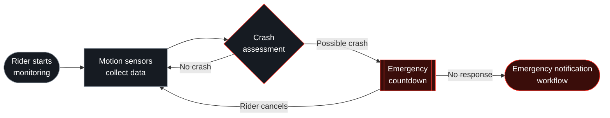

<div align="center">



<h3>An Android app that watches over motorcycle riders and raises the alarm when a crash may have happened.</h3>

<p>
  
  
  
  
</p>

<p>
  <a href="#features"><b>Features</b></a> &nbsp;·&nbsp;
  <a href="#how-it-works"><b>Architecture</b></a> &nbsp;·&nbsp;
  <a href="#getting-started"><b>Setup</b></a> &nbsp;·&nbsp;
  <a href="#roadmap"><b>Roadmap</b></a>
</p>

</div>

---

## The problem

After a serious motorcycle crash, a rider may be injured, unconscious or unable to reach their phone. If nobody sees it happen, nobody calls for help, and their family may not know what happened or where to look.

**VahakVigil is built to close that gap.** It monitors motion in the background, assesses whether a crash may have occurred, gives the rider a short window to cancel a false alarm, and otherwise starts an emergency notification workflow with their location.

---

## Features

<table>
  <tr>
    <td width="50%" valign="top">
      <h3>🧠 Intelligent crash assessment</h3>
      Accelerometer and gyroscope data feed crash-detection logic that produces a confidence score, so a single bump is not treated like a crash.
    </td>
    <td width="50%" valign="top">
      <h3>⏱️ Emergency countdown</h3>
      A possible crash starts a visible countdown. The rider can cancel it in one action if they are fine.
    </td>
  </tr>
  <tr>
    <td width="50%" valign="top">
      <h3>📍 GPS-assisted location</h3>
      The rider's position is captured so that the people who are notified know where to look.
    </td>
    <td width="50%" valign="top">
      <h3>📲 Emergency notification</h3>
      If the countdown is not cancelled, an SMS-based workflow alerts the rider's emergency contacts.
    </td>
  </tr>
  <tr>
    <td width="50%" valign="top">
      <h3>📈 Sensor dashboard</h3>
      A live view of motion-sensor readings, useful for development, calibration and understanding what the detector sees.
    </td>
    <td width="50%" valign="top">
      <h3>🩹 Bystander assistance</h3>
      A dedicated screen gives people who arrive at the scene basic first-aid guidance.
    </td>
  </tr>
</table>

A foreground service keeps safety monitoring running while the app is not on screen.

---

## How it works



---

## Built with

<p>
  
  
  
  
  
</p>

---

## Project status

VahakVigil is a **working prototype**. Features have been exercised on an Android device, but it has **not** yet been through controlled testing, so no accuracy or real-world reliability figures are claimed.

| | Implemented in the prototype |
|:-:|:--|
| ✅ | Crash detection from accelerometer and gyroscope data, with confidence scoring |
| ✅ | Emergency countdown with cancellation |
| ✅ | GPS location support |
| ✅ | SMS-based emergency notification workflow |
| ✅ | Sensor dashboard |
| ✅ | Bystander screen with basic first-aid guidance |
| ✅ | Foreground service for safety monitoring |

| | Still to do |
|:-:|:--|
| ⬜ | Controlled testing and measured detection performance |
| ⬜ | False-alarm evaluation |
| ⬜ | Device compatibility testing |
| ⬜ | Message-delivery validation |
| ⬜ | Supervised user evaluation |

---

## Getting started

**Requirements:** [Android Studio](https://developer.android.com/studio) and an Android device. A physical device is recommended, because the app depends on real motion sensors, GPS and SMS.

```bash
git clone https://github.com/manishchandraraturi/VahakVigil.git
```

1. Open the cloned `VahakVigil` folder in Android Studio.
2. Wait for the Gradle sync to finish. The SDK and Gradle versions come from the project's own Gradle files.
3. Connect a device with USB debugging enabled, select it, and press **Run**.
4. Grant the permissions the app requests on first launch (see below).

---

## Safety and privacy

> [!WARNING]
> VahakVigil is an experimental prototype. **Do not rely on it as your only way to request emergency help.** If you or someone else needs help, call your local emergency number (112 in India) directly.

- **Limitations:** crash detection can miss real crashes and can trigger false alarms. Its reliability has not been established.
- **Permissions:** the features above need access to device motion sensors, location, and the ability to send SMS, and background monitoring runs as a foreground service. The exact list is declared in the app's `AndroidManifest.xml`.
- **Network and coverage:** location needs GPS reception, and SMS delivery needs a SIM and cellular coverage. Without them, notifications may be delayed or may not be delivered.
- **Contacts:** only add people who have agreed to receive emergency messages from you.

---

## Roadmap

- [ ] Controlled testing of crash detection
- [ ] False-alarm evaluation across riding conditions
- [ ] Compatibility testing across Android devices
- [ ] Validation of emergency message delivery
- [ ] Supervised user evaluation

---

<div align="center">

### Built so that no rider has to wait alone.

<a href="https://github.com/manishchandraraturi/VahakVigil">Repository</a> &nbsp;·&nbsp;
<a href="https://github.com/manishchandraraturi/VahakVigil/issues">Issues</a> &nbsp;·&nbsp;
<a href="https://github.com/manishchandraraturi">Author</a>

</div>

<!--
SCREENSHOTS (add once you have real captures, then uncomment and delete this note):

## Screenshots

<table>
  <tr>
    <td align="center"><br><sub>Monitoring</sub></td>
    <td align="center"><br><sub>Countdown</sub></td>
    <td align="center"><br><sub>Sensor dashboard</sub></td>
    <td align="center"><br><sub>Bystander</sub></td>
  </tr>
</table>

Place this section right after "Features".
-->
